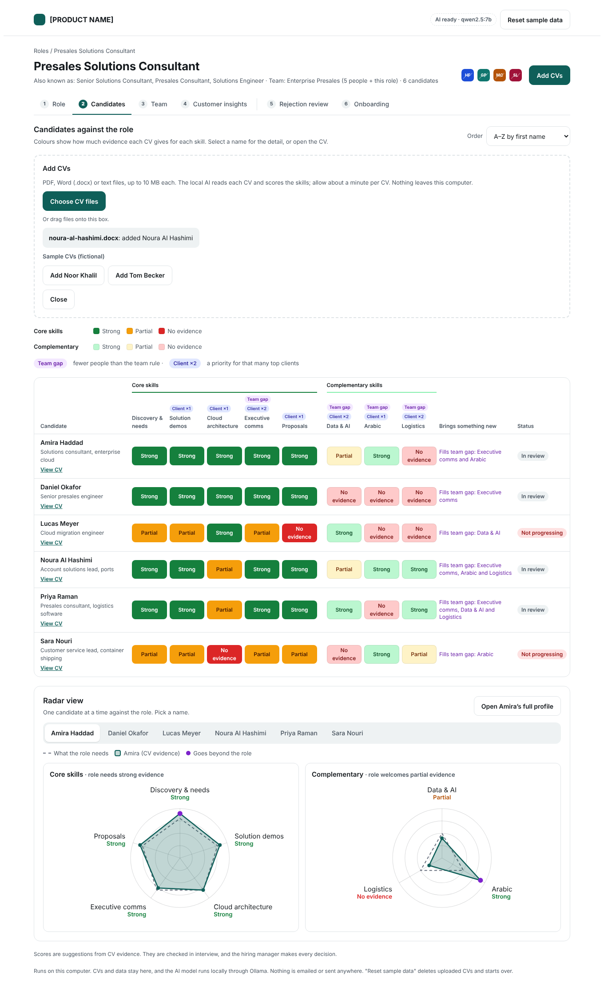

# Skills-First Hiring

**Hire the person who adds the most to your team and your clients, not another clone of the people you already have.**

Skills-First Hiring is a small, open-source web app for hiring managers. It compares each candidate's CV with the skills the role needs, the gaps in the current team and what your top clients care about. Then it helps you do two things most hiring tools skip: give every rejected candidate one honest reason, and give every new hire an onboarding plan with mentors.

It runs entirely on your own computer with Docker and an open-source AI model. CVs never leave the machine.



> **Status: MVP.** Built to test the idea with real hiring managers. All sample people, companies and CVs are fictional.

---

## What it does

| Tab | What you do |
| --- | --- |
| **1. Role** | Set the role, other titles the industry uses, your 3–5 top clients (with logos) and the core and complementary skills. |
| **2. Candidates** | Upload CVs (PDF, Word or text). A local AI scores the evidence for each skill and quotes the CV line behind every score. Compare everyone in a colour grid, or see one person at a time on a radar. |
| **3. Team** | Record how many people are strong in each skill, set the team rule, and mark possible mentors. A team radar shows the gaps. |
| **4. Customer insights** | A short survey per client: needs, recent wins and challenges, and the skills that matter most. |
| **5. Rejection review** | One honest reason per candidate, drafted by AI or a house template, with checks that block wording about years or age. Candidates must opt in to be kept for future roles. |
| **6. Onboarding** | A 30-60-90 day plan drafted by AI, and mentor pairing with a draft email and a 30-day follow-up reminder. |

## Principles

- **The system suggests; the manager decides.** Every score, message and plan is a draft until a person approves it.
- **Level of experience, never years.** The AI is told to judge complexity, scope and variety, and never age, years, gender, nationality or names.
- **Evidence or it doesn't count.** A score without a quote from the CV is capped. A paraphrased quote is marked and capped.
- **Privacy first.** Everything runs locally. Nothing is kept about candidates unless they opt in.

## Quick start

**Windows:** follow [SETUP-WINDOWS.md](SETUP-WINDOWS.md). It covers WSL 2, Docker Desktop and NVIDIA GPU setup step by step. Then double-click `start.bat`.

**Mac or Linux** (with Docker installed):

```bash
# With an NVIDIA GPU (Linux)
docker compose -f docker-compose.yml -f docker-compose.gpu.yml up -d --build
# Without a GPU (works everywhere, slower)
docker compose up -d --build
```

Open http://localhost:8080. On first start the AI model (about 4.7 GB) downloads in the background; the status in the top-right corner shows progress.

## How it works

```
Browser ──► app (Python, FastAPI)  ──► Ollama (local open-source model, e.g. Qwen 2.5 7B)
                 │
                 └─► SQLite + CV files in a Docker volume
```

- **app/** – the web page (`static/index.html`), the API (`main.py`), CV text extraction (`extract.py`), AI prompts and safety checks (`llm.py`) and the shared rules (`rules.py`).
- The AI is asked for structured JSON, and its answers are checked before they are shown. If the AI is unavailable or breaks the wording rules, the app falls back to plain rules and templates.

## Configuration

Copy `.env.example` to `.env`:

| Setting | Default | Meaning |
| --- | --- | --- |
| `OLLAMA_MODEL` | `qwen2.5:7b` | Any [Ollama](https://ollama.com/library) model. `llama3.1:8b` also works well on an 8 GB GPU. |
| `APP_PORT` | `8080` | The port the app opens on. |

## Development

```bash
pip install -r requirements.txt pytest
python -m pytest tests        # runs without Docker or a model: the AI is replaced by a stand-in
DATA_DIR=./data OLLAMA_URL=http://localhost:11434 uvicorn app.main:app --reload --port 8080
```

## Known limits

- Small local models make mistakes when reading CVs. Always check the quoted evidence and confirm in interview.
- One role at a time; no user accounts. It's designed for a single hiring manager on their own machine.
- Scanned (image-only) PDFs can't be read.
- Emails are drafts only: the app copies them for you to send from your own email. The opt-in link in rejection messages is a placeholder for your own form.
- Hiring decisions are regulated in many places (for example the EU AI Act treats AI in hiring as high-risk). Check what applies to you before using this with real candidates.

## Roadmap ideas

- A full TEAM gap view owned by the team, not just one hire
- Several roles and multiple users
- Connections to hiring systems and calendars
- A version for recruitment agencies

Contributions and ideas are welcome. Please open an issue first to discuss larger changes.

## Licence

[MIT](LICENSE). Use it, change it and share it.
